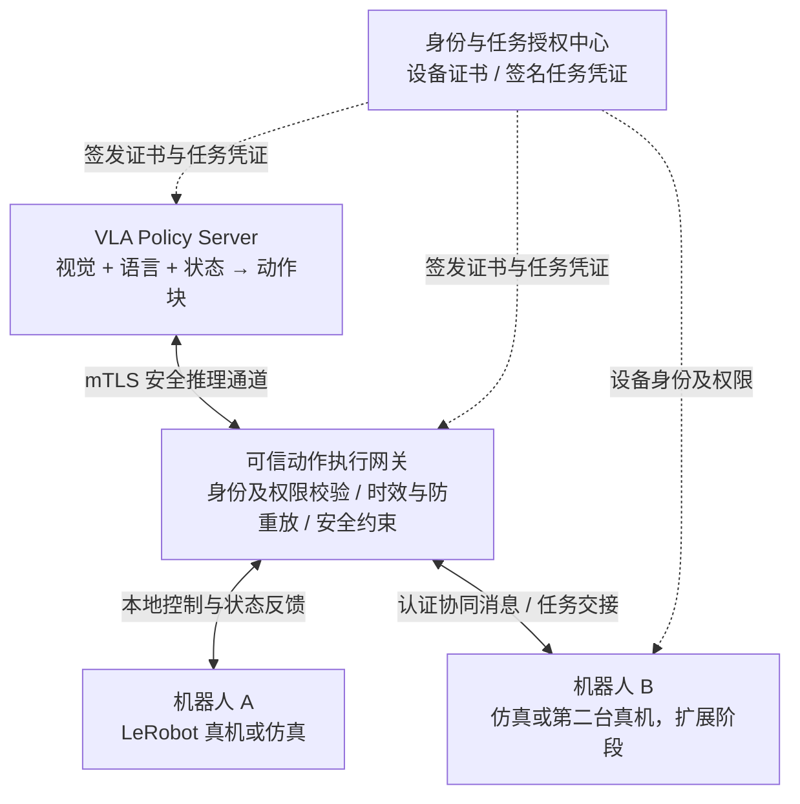

# 面向 VLA 具身机器人的安全通信与可信协作系统

**Secure Communication and Trusted Collaboration for VLA-Based Robotic Systems**

> **项目状态：方案设计 / 开发筹备中**  
> **项目类型：智能网联信息安全课程大作业**  
> **关键词：** VLA · 具身智能 · 端云协同 · 密码学 · mTLS · 身份认证 · 任务授权 · 动作块安全 · 多机器人协作

## 📌 项目简介

本项目面向 **Vision-Language-Action（VLA）驱动的机器人端云协同场景**，研究机器人通过网络访问远程策略模型、接收动作块（Action Chunks）并执行任务时的通信与控制安全问题。

项目以 [LeRobot](https://github.com/huggingface/lerobot) 为主要候选机器人框架，优先构建**单机器人—远程 VLA 推理服务器**的可运行安全闭环，再扩展到**多机器人任务交接与可信协作**。拟采用成熟的密码学机制实现设备双向认证、加密通信、签名任务授权和应用层防重放，并研究动作块过期、网络延迟与执行连续性之间的关系。

**项目目标不是设计新密码算法，而是将密码学身份、任务授权与 VLA 异步动作执行机制进行系统化集成与验证。**

> 本 README 描述的是计划架构、待开发功能和实验方案。除非后续版本明确更新状态，否则不代表相关模块已实现或验证通过。

## 🎯 研究问题

1. **端云通信可信性：** 如何确认机器人与 VLA 推理服务器的身份，并保护视觉观测、状态信息与动作命令的机密性、完整性？
2. **任务级授权：** 如何保证通过认证的设备只能执行被授权的任务，而非任意动作？
3. **异步动作块安全：** 如何识别重复提交、过期、跨任务混用或与当前观测上下文不一致的动作块？
4. **多机器人协作：** 不同机器人如何安全交换任务状态、验证交接事件并管理各自的操作权限？
5. **安全与实时性的平衡：** 密码学验证和时效检查会带来多大延迟，如何避免验证失败造成不受控的动作执行？

## 🏗️ 系统架构（规划）



**信任边界设计：**

- **授权中心**负责签发任务凭证；VLA 服务器不能自行扩大机器人的操作权限。
- **传输层**优先使用 TLS 1.3 双向认证（mTLS）保护机器人侧与服务器的网络通信；具体通信组件在基线版本选定后确定。
- **执行网关**在执行前检查任务授权、消息上下文、时效、序列号和本地动作约束。
- **本地安全控制**独立于密码学验证运行；有效签名**不等于**动作在物理上安全。
- 多机器人阶段为每台机器人配置**独立身份与权限**，而非共用一个账户或密钥。

## 🔐 密码学技术方案

| 技术 | 候选实现 | 作用 |
| --- | --- | --- |
| 设备身份认证 | X.509 证书、mTLS | 机器人与服务器双向认证 |
| 密钥协商与安全传输 | TLS 1.3 | 建立安全会话，保护远程推理链路 |
| 对称认证加密 | TLS 协商的 AEAD（如 AES-GCM） | 通信数据机密性与完整性 |
| 任务授权签名 | Ed25519 签名凭证 | 绑定机器人、任务、权限与有效期 |
| 数据摘要 | SHA-256（按需） | 观测/动作内容标识及一致性检查 |
| 应用层抗重放 | 任务 ID、会话 ID、序列号、有效期、状态机 | 阻止重复任务、旧动作或跨任务复用 |

**设计原则：** 优先复用经过验证的密码库和协议，不自行发明加密算法；避免重复叠加无必要的加密层。TLS 可以保护连接，但不自动解决应用层的任务授权、跨会话重复提交或动作过期问题。

## 🧩 核心模块

### A. 端云安全控制（必须完成）

- [ ] 运行 LeRobot/候选 VLA 的远程推理基线；优先使用 MockRobot 或仿真。
- [ ] 通过独立计算节点或进程实现机器人—服务器网络通信。
- [ ] 配置设备证书、mTLS 和非法客户端拒绝机制。
- [ ] 为机器人签发具有任务范围和有效期的签名授权凭证。
- [ ] 在可信网关执行动作块准入检查、日志记录和安全拒绝。
- [ ] 在隔离环境中完成通信安全与执行安全对照实验。

### B. 多机器人可信协作（扩展目标）

- [ ] 增加第二个独立机器人节点（可为纯仿真节点）。
- [ ] 为不同机器人设置独立身份及任务权限。
- [ ] 实现协作事件（如“交接完成”）的来源认证、任务绑定和抗重放。
- [ ] 研究节点加入、退出及任务权限撤销。
- [ ] 实现一真一虚或双仿真的协同分拣/任务交接演示。

### C. 安全与实时性评估（研究重点）

- [ ] 分析 mTLS、任务验证对延迟和吞吐的影响。
- [ ] 在不同延迟、抖动和乱序条件下评估动作块时效性。
- [ ] 比较旧动作拒绝、等待新预测及安全停止策略的表现。
- [ ] 衡量动作队列耗尽、任务成功率、超时停止和误拒绝率。

## 📦 可信动作块设计（拟议接口）

以下是**本项目拟议的逻辑消息格式**，不是 LeRobot 官方现有 API：

```json
{
  "robot_id": "robot_a",
  "task_id": "task_001",
  "session_id": "session_example",
  "observation_id": "obs_042",
  "chunk_seq": 12,
  "issued_at": "2026-10-08T08:00:00Z",
  "expires_at": "2026-10-08T08:00:01Z",
  "actions": "<serialized action chunk>",
  "authorization_ref": "token_001"
}
```

> 上述 ID、时间及动作内容均为**结构示例**，不代表固定采样频率或生产环境凭证。实际实现将定义规范化序列化、字段校验、时钟/单调序列处理和消息大小限制。

网关的预期检查逻辑：

1. 确认消息来自已认证的通信对端，且位于正确的会话中。
2. 验证授权中心签发的任务凭证、目标机器人、权限范围及有效期。
3. 检查 `task_id`、`observation_id`、`chunk_seq` 与当前执行上下文是否匹配。
4. 拒绝重复、越权或已经过期的动作块；允许合法的异步乱序处理策略。
5. 对通过校验的动作执行独立的工作空间、速度/限位等物理安全检查。
6. 对拒绝事件记录原因，并根据安全策略选择等待、重新推理或安全停止。

## 🛡️ 威胁模型与保护边界

**优先防护的威胁：**

- 未授权设备接入、机器人/服务器身份冒充；
- 传输链路中的窃听、消息篡改与伪造；
- 合法账户或节点尝试执行超出授权范围的任务；
- 应用层历史任务或旧动作块重复提交；
- 过期动作或跨任务动作误进入执行队列；
- 多机器人协同事件伪造、重复交接与权限混用。

**不宣称单凭本系统解决：** 已遭攻陷的合法推理端产生的任意恶意动作、恶意视觉输入对模型的诱导、设备物理入侵、无线干扰/拒绝服务，以及所有机器人碰撞风险。这些需要额外的模型安全、硬件安全与控制安全机制。

## 🧪 实验设计

| 对照组 | 通信保护 | 任务授权 | 动作上下文/时效验证 |
| --- | --- | --- | --- |
| G0 | 无（仅隔离实验基线） | 无 | 无 |
| G1 | mTLS | 无 | 无 |
| G2 | mTLS | 有 | 基本任务校验 |
| G3 | mTLS | 有 | 完整上下文绑定、防重放与恢复策略 |

**测试场景：** 未授权连接、链路篡改、跨任务越权、重复任务提交、过期动作块、网络延迟/抖动、双机器人交接消息伪造。

**评价指标：** 非法消息接受率、合法消息误拒率、通信 RTT、P50/P95 延迟、验证开销、动作块过期率、队列耗尽次数、任务成功率，以及安全停止次数。

所有安全测试均限定在**授权、隔离的测试环境**；真机只在限位、低速、急停与现场监护条件下运行。结果将在实际测试后公布，不预设实验结论。

## 🗓️ 开发计划

| 周次 | 目标 | 可验收产物 |
| --- | --- | --- |
| W1 | 固定 LeRobot 版本，跑通远程推理与 MockRobot | 可复现基线与环境记录 |
| W2 | 建立设备证书、mTLS 和身份认证 | 安全连接与拒绝测试 |
| W3 | 实现签名任务凭证与可信动作网关 | 越权、防重放的单元测试 |
| W4 | 对照安全实验与性能评估 | 延迟、通过率和执行数据 |
| W5 | 加入独立第二机器人节点 | 可信交接演示（扩展） |
| W6 | 完善真机/仿真展示及课程报告 | 演示视频、实验报告与代码整理 |

## 🧰 技术栈（候选）

- **机器人与策略：** LeRobot、SmolVLA 或实验室已有 VLA 模型
- **语言与运行：** Python，独立 Conda 环境
- **通信：** gRPC 或 Zenoh（依据锁定的 LeRobot 基线选型）
- **密码库与证书：** OpenSSL、Python `cryptography`、TLS/mTLS
- **仿真/硬件：** MockRobot、LeRobot SO-100/SO-101（视实验室设备而定）及适配仿真
- **实验与可视化：** pytest、结构化日志、延迟统计与图表

**兼容性提醒：** LeRobot 的远程推理接口处于演进中。开发时将记录具体 Git commit/版本、模型权重、Python 版本及依赖锁定文件，避免直接依赖不断变化的 `main` 分支。

## 📁 仓库结构（计划）

下述目录仅是**建议结构**，目前不保证仓库中已存在这些文件：

```text
.
├── README.md
├── configs/                 # 通信、设备与策略配置
├── security/                # PKI、任务签名与凭证校验
├── gateway/                 # 动作块验证与执行状态机
├── adapters/                # LeRobot / gRPC / Zenoh 适配
├── robots/                  # 真机与仿真节点封装
├── experiments/             # 隔离攻击测试与性能评估
├── tests/                   # 单元与集成测试
└── docs/                    # 架构、威胁模型及实验报告
```

## 🚀 如何开始

**当前尚处于项目初始化阶段，暂未提供可验证的一键安装或启动命令。** 计划按以下顺序建设可复现环境：

1. 选定 LeRobot 的稳定版本/固定提交，并创建隔离 Conda 环境。
2. 使用 MockRobot + 远程策略服务完成基线验证。
3. 加入证书与安全传输，验证设备的合法接入与拒绝行为。
4. 实现任务授权和可信动作网关，并用单元测试验证拒绝规则。
5. 接入仿真，再在满足安全条件时接入真机。
6. 加入第二机器人节点，完成协同交接和性能对照。

后续将补充 `environment.yml`、启动脚本、示例配置、测试数据和复现实验说明。**不得提交私钥、真实证书密钥或含敏感信息的日志。**

## 📚 参考资料

### 官方框架与安全文档

- [Hugging Face LeRobot](https://github.com/huggingface/lerobot)
- [LeRobot：Asynchronous Inference](https://huggingface.co/docs/lerobot/async)
- [LeRobot：SmolVLA](https://huggingface.co/docs/lerobot/smolvla)
- [LeRobot Remote Inference Engine 开发 PR #4836](https://github.com/huggingface/lerobot/pull/4836)（开发状态以官方页面为准）
- [gRPC Python Authentication 示例](https://github.com/grpc/grpc/blob/master/examples/python/auth/README.md)
- [Zenoh TLS Authentication](https://zenoh.io/docs/manual/tls/)
- [Zenoh Access Control](https://zenoh.io/docs/manual/access-control/)
- [SROS2](https://github.com/ros2/sros2)

### 相关研究

- [AuthGuard-R: Safety-Compliant Mission Hijacking and Dual-Gate Defense for LLM-Controlled Robots (2026)](https://arxiv.org/abs/2609.31110) — 签名任务绑定与授权检查相关工作；项目不将其已有思想宣称为原创。
- [SmolVLA: A Vision-Language-Action Model for Affordable and Efficient Robotics (2025)](https://arxiv.org/abs/2506.01844) — VLA 与动作块推理基础。

## 🤝 项目协作

本项目面向课程团队协作开发。建议使用 GitHub Issues 管理任务、Pull Requests 审核代码，并在合并前执行单元测试与必要的安全检查。具体成员分工和贡献规范将在项目启动后补充。

## 📄 许可证

**待定。** 在仓库添加明确的 `LICENSE` 文件之前，请勿假定该项目已授予开源使用许可。第三方框架、模型权重和数据集须遵守各自许可证。

---

> **课程定位：** 本项目围绕“智能网联信息安全”，以密码学设备认证、安全通信和任务授权为基础，以 VLA 异步动作执行与多机器人协作作为实验应用场景。功能、创新性与性能结论均以最终实现和实验为准。
